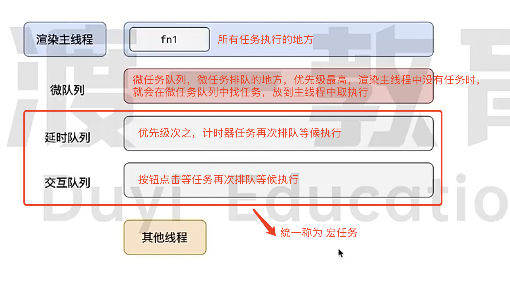

#### 从地址栏输入 url 到页面流程

1、浏览器自动补全协议、端口
2、浏览器自动完成url编码
3、浏览器根据url地址查找本地缓存，根据缓存规则看是否命中缓存，若命中缓存则直接使用缓存，不再发出请求
4、通过DNS解析找到服务器的IP地址
5、浏览器向服务器发出建立TCP连接的申请，完成三次握手后，连接通道建立
6、若使用了HTTPS协议，则还会进行SSL握手，建立加密信道。使用SSL握手时，会确定是否使用HTTP2
7、浏览器决定要附带哪些cookie到请求头中
8、浏览器自动设置好请求头、协议版本、cookie，发出请求
9、服务器处理请求，进入后端处理流程。完成处理后，服务器响应一个HTTP报文给浏览器。
10、浏览器根据使用的协议版本，以及Connection字段的约定，决定是否要保留TCP连接。
11、浏览器根据响应状态码决定如何处理这一次响应
12、浏览器根据响应头中的Content-Type字段识别响应类型，如果是text/htm1，则对响应体的内容进行HTML解析，否则做其他处理
13、浏览器根据响应头的其他内容完成缓存、cookie的设置
14、浏览器开始从上到下解析HTML，若遇到外部资源链接，则进一步请求资源
15、解析过程中生成DOM树、CSSOM树，然后一边生成，一边把二者合并为渲染树(rendering tree)，随后对渲染树中的每个节点计算位置和大小(reflow)，最后把每个节点利用GPU绘制到屏幕(repaint)
16、在解析过程中还会触发一系列的事件，当DOM树完成后会触发D0MContentLoaded事件，当所有资源加载完毕后会触发1oad事件

#### 请求方法
在实践中，客户端和服务器慢慢的形成了一个共识，约定俗成的规定了一些常见的请求方法

1、GET，业务数据在请求行中，无须请求体GET，表示向服务器获取资源。
2、POST，表示向服务器提交信息，通常用于产生新的数据，比如注册。业务数据在请求体中。
3、PUT，表示希望修改服务器的数据，通常用于修改。业务数据在请求体中
4、DELETE，表示希望删除服务器的数据。业务数据在请求行中，无须请求体
5、OPTIONS，发生在跨域的预检请求中，表示客户端向服务器申请跨域提交
6、TRACE，回显服务器收到的请求，主要用于测试和诊断
7、CONNECT，用于建立连接管道，通常在代理场景中使用，网页中很少用到

#### 请求报文组成
一个完整报文组成

请求行
请求头

请求体

#### cookie、session、localstorage
cookie
由 关键值组成的键值对、domain 域、path 路径、secure 是否安全传输、expire 是否过期、max-age 相对过期时间 等组成

如果一个cookie同时满足以下条件，则这个cookie会被附带到请求中
1、cookie没有过期 -> expire
2、cookie中的域和这次请求的域是匹配的 -> domain
    2.1、比如cookie中的域是 yuanjin.tech，则可以匹配的请求域是 yuanjin.tech、www.yuanjin.tech、blogs.yuanjin.tech 等这样的请求域
    2.2、比如cookie中的域是 www.yuanjin.tech，则只能匹配 www.yuanjin.tech 的请求域
    2.3、域Cookie是不在乎端口的，只要域匹配即可。
3、cookie中的path和这次请求的path是匹配的。 -> path
    3.1、比如cookie中的path是 /news，则可以匹配的请求路径可以是 /news、 /news/detail、 /news/a/b/c 等等，但不能匹配 /blogs
    3.2、如果cookie的path是 /，可以想象，能够匹配所有的路径。
4、验证cookie的安全传输 -> secure
    4.1、如果cookie的secure属性是true，则请求协议必须是 https，否则不会发送该cookie
    4.2、如果cookie的secure属性是false，则请求协议可以是 http，也可以是 https

cookie/sessionStorage/localstorage 的区别
参考答案:
cookie、sessionStorage、localStorage 都是保存本地数据的方式
其中，cookie 兼容性较好，所有浏览器均支持。浏览器针对 cookie 会有一些默认行为，比如当响应头中出现 set-cookie 字段时，浏览器会自动保存 cookie 的值;再比如，浏览器发送请求时，会附带匹配的 cookie 到请求头中。这些默认行为，使得cookie 长期以来担任着维持登录状态的责任。与此同时，也正是因为浏览器的默认行为给了恶意攻击者可乘之机，CSRF攻击就是一个典型的利用 cookie 的攻击方式。虽然cookie 不断的改进，但前端仍然需要另一种更加安全的保存数据的方式
HTML5 新增了 sessionStorage 和 localStorage，前者用于保存会话级别的数据，后者用于更持久的保存数据。
浏览器针对它们没有任何默认行为，这样一来，就把保存数据读取数据的工作交给了前端开发者，这就让恶意攻击者难以针对登录状态进行攻击。
cookie 的大小是有限制的，一般浏览器会限制同一个域下的 cookie 总量为 4M，而sessionStorage 和 localStorage 则没有限制，cookie 会与 domain、path 关联，而 sessionStorage 和 localstorage 只与domain 关联，有同源策略的限制。

#### 跨域问题

1、针对的是浏览器和服务端的
2、同源策略是浏览器的限制
端口、协议、主机三者有一个不相同，就是跨域

解决方式

代理、jsonp、CORS

jsonp 只能发送 get 请求，本质是生成一个 script 标签的，利用同源策略对 src 等没有限制，src的 url 只是普通的路径，get 请求。
并且需要服务端配合，路径里面的回调函数需要前后端保持一致。

CORS
access-control-allow-origin

1、简单请求
2、预检请求
3、附带身份证明的请求

简单请求
如果是简单请求，在进行跨域访问时，浏览器会自动在请求头字段中加入一个 origin 的字段，
表示，我是从哪一个源过来的，服务端接收到之后，判断这个源能不能访问我的资源，
如果能，就会在响应中加上 Access-Control-Allow-Origin 的字段记录 origin 的值，并返回给浏览器，同时返回需要的资源。

同时满足下列三个要求

1、请求方法属于下面的一种:
    1、get
    2、post
    3、head

2、请求头仅包含安全的字段，常见的安全字段如下:
    Accept
    Accept-Language
    Content-Language
    Content-Type
    DPRI
    Downlink
    Save-Data
    Educo
    Viewport-Width
    Width

3、请求头如果包含Content-Type，仅限下面的值之一:
    1、text/plain
    2、multipart/form-data
    3、application/x-www-form-urlencoded

预检请求
options
1、向服务发送预检请求，询问服务端，这个请求是否允许，如果允许，不会有返回值，
2、只会在响应头中，返回发送请求时，携带的字段，表明这些字段我是可以接受，其他字段我不接受；
比如说，预检请求时，请求的字段 
access-control-request-header, 
access-control-request-method 方法，
origin 来源来自哪里，发给服务端，
如果服务端允许，就会返回给客户端
access-control-allow-header
access-control-allow-method,
access-control-allow-origin
分别对应上面请求的字段

附带身份证明的请求
重要的字段是 设置 withCredential 为true，表明要进行身份验证，那么请求时，需要携带cookie，此时服务端响应头中，需要使用 access-control-allow-Credential 为true，同时  access-control-allow-origin 不能为 *, 要具体

需要预检的请求是非简单请求

#### CSRF 攻击
跨站请求伪造
CSRF 是跨站请求伪造，是一种挟制用户在当前已登录的Web应用上执行非本意的操作的攻击
方法
当用户访问网站后，网站会发送请求到被攻击的站点，它首先引导用户访问一个危险网站，再次请求会携带用户的cookie发送，因此就利用了用户的身份信息完成攻击。

防御手段

不使用cookie，
1、兼容性略，ssr会遇到困难，但可解决

使用 sameSite，
1、原理是限制访问的源，不是来自于同一个网站的请求，即使携带了用户的关键信息请求也不被响应；
2、容易挡住自己人
设置 sameSite = lax 比较宽松的请求策略，部分 get 请求会带 cookie，post 请求不会带；
设置 sameSite = strict 任何请求都不允许带 cookie 

使用csrf token -> 推荐方式
获取到token后未进行操作仍然会被攻击 -> 概率很低
原理是用户访服务器的时候，服务器随机生成一个 token，返回给客户端，客户端可以执行如下操作
1、将 token 存在  cookie 中，并且设置 httpOnly，客户端脚本就无法访问cookie (js 不能读取 cookie)
2、将 token 存储在 请求头中，根据同源策略，其他源的请求不能请求本源的数据

使用referer防护，过去很常用，现在已经发现漏洞

#### XSS 攻击
跨站脚本攻击
XSS(Cross Site Scripting，跨站脚本攻击)，是指攻击者利用站点的漏洞，在表单提交时，在表单内容中加入一些恶意脚本，当其他正常用户浏览页面，而页面中刚好出现攻击者的恶意脚本时，脚本被执行，从而使得页面遭到破坏，或者用户信息被窃取。

防御
服务器端对用户提交的内容进行过滤或编码
过滤: 去掉一些危险的标签，去掉一些危险的属性
编码: 对危险的标签进行HTML实体编码

#### 长轮询、短轮询、websocket 连接
短轮询
1、客户端隔一段时间向服务端发送请求，服务端频繁关闭开启连接
2、产生大量的无意义的请求

长轮询
一定的解决了短轮询的频繁开启关闭的问题
客户端发送请求给服务端，服务端收到请求后，如果没有新的数据，就会一直等有新的数据之后，在返回给客户端；
缺点：
1、服务端长时间等待，造成服务端资源浪费；
2、长时间等待，可能造成服务端以为客户端没有请求，从而主动关闭请求连接；

websocket

1、建立websocket 连接，先完成 tcp/ip 的三次握手；
2、然后在再进行 websocket 握手，建立 websocket 连接；

websocket 协议 HTML5 带来的新协议，相对于 http，它是一个持久连接的协议它利用 http 协议完成握手，然后通过TCP 连接通道发送消息使用 websocket协议可以实现服务器主动推送消息。
1、首先，客户端若要发起 websocket 连接，首先必须向服务器发送 http 请求以完成握手，请求行中的 path 需要使用 ws:开头的地址，
请求头中要分别加入 upgrade、connection、Sec-WebSocket-Key、Sec-WebSocket-Version 标记
2、然后，服务器收到请求后，发现这是一个 websocket 协议的握手请求，于是响应行中包含 Switching Protocols，
同时响应头中包含 upgrade、connection、Sec-WebSocket-Accept 标记
3、当客户端收到响应后即可完成握手，随后使用建立的 TCP 连接直接发送和接收消息

socket.io: websocket 第三方库

#### 浏览器渲染流程知识点
如果主线程解析到 link 位置，此时外部的 CSS 文件还没有下载解析好，主线程不会等待，继续解析后续的 HIML。这是因为下载和解析
CSS 的工作是在预解析线程中进行的。这就是 CSS 不会阻塞 HIML 解析的根本原因。

浏览器渲染整个流程 

1、解析 html -> parse

主要任务是渲染主线程对 html 的解析
接收到服务端返回  html 字符串文本之后，将字符串进行标记化处理，也就是就进行词法分析，解析出 html node 节点，然后构建dom树。
在解析html 的过程中，会首先整体分析一下 html 中有哪些加载外部资源的标签 link 或者 script等，那么此时，浏览器会开启另一个 预解析线程，预先 加载外部的 css、js 资源。
在解析到 link 标签时，如果 css 资源还没加载好，渲染主线程不会等待加载，而是继续解析html。
下载和解析CSS 的工作是在 `预解析线程` 中进行的。这就是 CSS 下载和解析 不会阻塞 HTML 解析的根本原因，但是可能会阻塞渲染。
同样解析到 script 标签位置时，会等待js 下载完成，等待js 解析执行完成之后，再解析 html，这也是 js 会阻塞 html 解析的根本原因。
在 css 资源，经历过 标记化处理 等流程后，会形成一个cssom tree 返回给 渲染主线程。
等到 html 解析完成，形成一个 dom tree。

2、样式计算(style)-> cssom tree & dom tree -> computed style -> 样式规则树(渲染树 render tree)
有了dom树和cssom 树之后，渲染主线程，会递归遍历dom 树，根据 cssom tree 依次为 dom 节点计算最终的样式，最终生成一个 样式规则树，记录每一个 dom 的样式

3、布局（layout） -> layout tree
这个过程中，渲染主线程需要遍历上一步中生成的样式规则树，根据样式，计算出每一个节点的位置，大小等信息，最终输出 布局树。
需要注意的是，样式规则树和生成的布局树不是一一对应的关系，会根据样式中的隐藏等属性，不显示某些 dom 节点。

4、分层 -> layer
分层的好处是，将页面分为多层，那么某一个层级修改，不会影响其他层，提升效率。
此过程中，渲染主线程，需要遍历layout 树，生成一个 层次树 layer tree。
比如说  transform、opacity、z-index 属性等会影响分层

5、生成绘制指令 -> 根据以上的输出，生成多个绘制指令
渲染主线程，会为每个单独的层级生成一个单独的指令集，后续步骤会根据指令集进行绘制。

6、分块 -> 将上个步骤的结果，交给另一个 合成线程 处理
到达此过程之后，渲染主线程的工作暂时退出，交给合成线程处理
将图层进行分块后，合成线程将 块交给多个其他线程进行处理，做完后，交给合成线程处理。
变形、旋转、缩放等样式处理是在 `合成线程` 中进行，也是 transform 等不会影响，渲染主线程的原因。

7、光栅化 -> 交给 gpu 线程处理
将处理后的块，进行光栅化处理，将块进行位图处理，简单的理解就是处理每一个 块的 rgb 信息。此过程是 gpu 线程处理

8、绘制
最后根据光栅化后的结果，绘制出页面。

10、常见面试题
reflow 影响的是 布局树 layout tree
repaint 影响的的是 重新生成绘制指令 paint
transform 既不影响布局也不影响绘制，只是影响 draw 过程，此过程发生在合成线程中，不会影响主线程

渲染主线程 = parse -> style -> layout -> layer -> paint
合成线程   = -----------------------------------------> tiling -> raster -> draw

#### **解决浏览器渲染阻塞**
1、defer & async
    1、defer：DOM 结构完全生成，以及其他脚本执行完成，才会执行（等待dom结构渲染完再执行）。有多个 defer 脚本时，会按照页面出现的顺序依次加载、执行。
    2、async：一旦下载完成，渲染引擎就会中断渲染，执行这个脚本以后(下载完就执行），再继续渲染（有多个 async 脚本时，不能保证按照页面出现顺序加载、执行

2、preload
    预加载当前页的资源
    比如说，首屏加载，可以预先加载资源，减少渲染时间
    preload 指令的一些优点如下
    1、允许浏览器设置资源优先级，从而允许 Web 开发人员优化某些资源的交付。
    2、使浏览器能够确定资源类型，因此它可以判断将来是否可以重用相同的资源
    3、浏览器可以通过引用 as 属性中定义的内容来确定请求是否符合内容安全策略。
    4、浏览器可以根据资源类型发送合适的 Accept 头(例如:image/webp)

3、prefetch
    1、用于加载非首页的其他页面的资源，便于加快后面页面的显示速度
    2、将资源放进缓存至少5分钟，无论此资源能不能缓存
    3、如果页面跳转，并不会中断 prefetch 的过程

4、prerender
    提前收集，渲染非当前页面

5、preconnect
    预先建立资源连接，可以省去建立连接的事件，更快的访问所需要的资源

#### 事件循环
1、如何理解 js 的异步

JS是一门单线程的语言，这是因为它运行在浏览器的渲染主线程中，而渲染主线程只有一个.
而渲染主线程承担着诸多的工作，渲染页面、执行 JS 都在其中运行。
如果使用同步的方式，就极有可能导致主线程产生阻塞，从而导致消息队列中的很多其他任务无法得到执行。
这样一来，一方面会导致繁忙的主线程白白的消耗时间，另一方面导致页面无法及时更新，给用户造成卡死现象。所以浏览器采用异步的方式来避免。
具体做法是当某些任务发生时，比如计时器，主线程将计时器任务交给其他线程去处理，当其他线程完成时，将事先传递的回调函数包装成任务，加入到消息队列的未尾排队，等待主线程调度执行。在这种异步模式下，浏览器永不阻塞，从而最大限度的保证了单线程的流畅运行。

宏任务、执行顺序

如果延时队列和交互队列都有任务，那么一定是先执行交互队列中的任务，因为，浏览器需要保证用户的操作得到及时的响应

